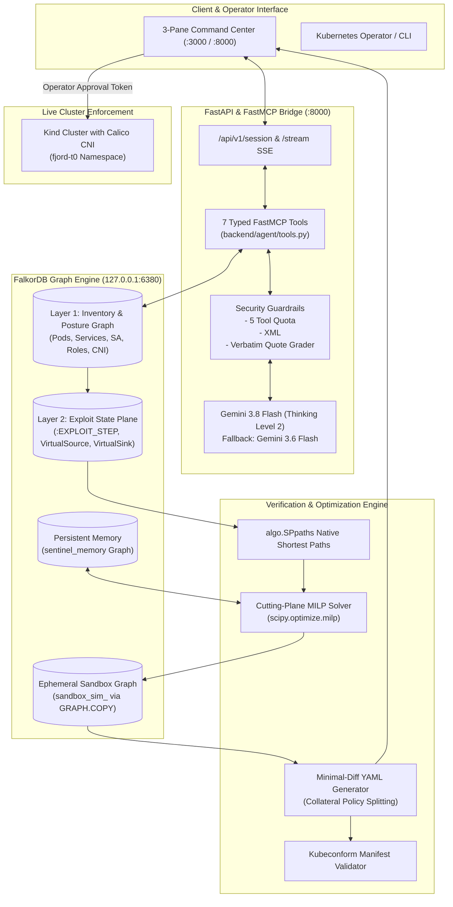

# Fjord: Autonomous Cloud & Container Security Posture & Exploit-Path Remediation Agent

[](https://wemakedevs.org)
[](https://falkordb.com)
[](https://scipy.org)
[](https://kubernetes.io)
[](LICENSE)

> **WeMakeDevs FalkorDB Hackathon Track 1 Submission ("Agents That Act on Connected Data")**  
> Provably safe, counterfactually verified attack-path severing and minimal-diff Kubernetes remediation powered by FalkorDB native graph algorithms and mixed-integer linear programming (MILP).

---

## 1. Executive Summary & Track 1 Alignment

Modern cloud-native clusters are dense interconnected graphs of pods, namespaces, network policies, RBAC bindings, service accounts, and cloud IAM permissions. Security scanners (Trivy, Prowler, CSPMs) generate thousands of isolated alerts without modeling multi-hop lateral exploitability. Meanwhile, naive LLM security agents either hallucinate invalid graph traversal queries or propose blanket network isolations that crash core business services.

**Fjord** solves this with an autonomous, graph-native remediation agent engineered specifically for **FalkorDB**:
1. **Act on Connected Data:** Fjord continuously transforms raw Kubernetes manifests, CNI reachability matrices, container vulnerabilities, and cloud findings into a dual-layer FalkorDB graph.
2. **Deterministic Exploit State Plane:** Using parameterized Cypher templates and native `algo.SPpaths`, Fjord compiles and traverses lateral attack paths without LLM query hallucination.
3. **Safety-Gated Remediation:** Fjord pairs a cutting-plane Mixed-Integer Linear Programming (MILP) solver (`scipy.optimize.milp`) with native `GRAPH.COPY` counterfactual sandboxing. Remediations are verified inside an isolated clone before copyable Kubernetes manifests are emitted for operator approval.

---

## 2. Competitive Landscape & Honest Prior Art

Fjord builds on foundational work in cloud and container graph modeling while establishing a distinct technical wedge in **counterfactual sandbox verification** and **constrained minimal-diff remediation**:

| Solution | Graph Model & Engine | Attack-Path Traversal | Remediation Generation | In-Graph Sandboxing | Business Flow Invariance |
| :--- | :--- | :--- | :--- | :--- | :--- |
| **Datadog KubeHound** | JanusGraph / Gremlin | Static offline traversal | Manual operator | None | None |
| **KubeHound `exp/` MCP Agent** | JanusGraph / Neptune | LLM-driven Gremlin/Cypher | LLM suggestions | None (Direct apply risk) | None |
| **Cyntrisec** | Neo4j / AWS Graph | Cypher path queries | Rule-based suggestions | None | None |
| **cloud-pathfinder** | In-Memory DiGraph | Custom DFS/BFS | Rule-based | None | None |
| **Cartography (Lyft)** | Neo4j | APOC / Cypher | Read-only inventory | None | None |
| **FJORD (Our Work)** | **FalkorDB (Dual-Layer)** | **Native `algo.SPpaths`** | **Cutting-Plane MILP** | **Native `GRAPH.COPY` Simulation** | **Hard Invariant ($x_m = 0$)** |

### Fjord's Technical Wedge
- **No Cypher Hallucination:** The LLM never writes raw OpenCypher; all graph traversals and exploit-plane compilations use parameterized Cypher templates or FalkorDB native algorithms (`algo.SPpaths`).
- **Mathematical Disruption Minimization:** Instead of greedy or blanket workload isolation, Fjord solves a minimum hitting-set problem over active attack paths while strictly protecting required business dependencies.
- **Counterfactual In-Graph Sandboxing:** Before an operator sees a proposed patch, Fjord duplicates the live graph in milliseconds via native `GRAPH.COPY`, simulates the candidate mutation, and proves 0 surviving paths and 0 broken flows.

---

## 3. End-to-End System Architecture



---

## 4. FalkorDB Integration: Exact OpenCypher Queries & Procedures

Fjord's architecture is powered by explicit, parameterized OpenCypher templates executed against FalkorDB. Below are the core queries driving the engine:

### 1. Lateral Network Reachability Compiler Pass
Synthesizes Layer 2 `:EXPLOIT_STEP` edges connecting unsegmented workloads:
```cypher
MATCH (src:Workload)-[r:CAN_REACH_NET]->(dst:Workload)
WHERE NOT (src)-[:EXPLOIT_STEP {step_type: 'NETWORK_REACH'}]->(dst)
CREATE (src)-[:EXPLOIT_STEP {
    step_type: 'NETWORK_REACH',
    protocol: r.protocol,
    port: r.port,
    cost: 1.0,
    source_layer: 'CNI'
}]->(dst)
```

### 2. ServiceAccount & RBAC Secret Escalation Compiler Pass
Compiles attack steps from workloads mounting ServiceAccounts that hold secret-reading RBAC permissions:
```cypher
MATCH (w:Workload)-[:USES_SA]->(sa:ServiceAccount)-[:BOUND_TO]->(r:RBACRole)-[a:ALLOWS_API]->(cj:CrownJewel)
WHERE (r.allows_secrets_get = true OR r.allows_wildcard = true OR a.verb IN ['get', 'list', '*'])
  AND (cj.category = 'K8S_SECRET' OR cj.type = 'Opaque')
CREATE (w)-[:EXPLOIT_STEP {
    step_type: 'SECRET_ACCESS',
    cost: 0.5,
    sa_id: sa.id,
    role_id: r.id,
    target_secret: cj.id
}]->(cj)
```

### 3. Multi-Hop Attack Path Discovery via Native `algo.SPpaths`
Discovers lateral exploit chains between the external attacker super-source and the targeted crown jewel:
```cypher
MATCH (s:VirtualSource {id: 'virtual:source'}), (d:VirtualSink {id: 'virtual:sink'})
CALL algo.SPpaths({
    sourceNode: s,
    targetNode: d,
    relTypes: ['EXPLOIT_STEP'],
    maxDepth: 15
})
YIELD path, weight
RETURN [n in nodes(path) | n.id] AS node_ids,
       [r in relationships(path) | type(r)] AS rel_types,
       weight
ORDER BY weight ASC
LIMIT 5
```

### 4. Counterfactual Sandbox Cloning via Native `GRAPH.COPY`
Duplicates the live cluster snapshot into an isolated sandbox in milliseconds:
```cypher
GRAPH.COPY prod_t0slice sandbox_sim_6f7a8b
```

---

## 5. Empirical Verification: Task 0 Live Calico CNI Truth Table

Fjord was empirically verified against a live Kubernetes `kind` cluster running **Calico CNI** (`fjord-t0` namespace) containing 3 workloads: `ingress-proxy`, `api-service`, and `crown-jewel-db`.

A full 6-pair directed `nc -z -w 2` connection matrix was executed before and after applying Fjord's minimal-diff remediation:

```
==========================================================================================
CNI REACHABILITY TRUTH TABLE: 6-PAIR DIRECTED CONNECTION MATRIX
==========================================================================================
Source           Destination      Phase    Predicted  Actual     Status   Description
------------------------------------------------------------------------------------------
ingress-proxy    api-service      BEFORE   ALLOW      ALLOW      PASS     Required Business Flow
ingress-proxy    crown-jewel-db   BEFORE   ALLOW      ALLOW      PASS     Lateral Reachability
api-service      ingress-proxy    BEFORE   ALLOW      ALLOW      PASS     Reverse Direction Flow
api-service      crown-jewel-db   BEFORE   ALLOW      ALLOW      PASS     Target Attack Path
crown-jewel-db   ingress-proxy    BEFORE   ALLOW      ALLOW      PASS     Reverse Direction Flow
crown-jewel-db   api-service      BEFORE   ALLOW      ALLOW      PASS     Reverse Direction Flow
------------------------------------------------------------------------------------------
ingress-proxy    api-service      AFTER    ALLOW      ALLOW      PASS     Required Business Flow
ingress-proxy    crown-jewel-db   AFTER    BLOCKED    BLOCKED    PASS     Lateral Reachability
api-service      ingress-proxy    AFTER    ALLOW      ALLOW      PASS     Reverse Direction Flow
api-service      crown-jewel-db   AFTER    BLOCKED    BLOCKED    PASS     Target Attack Path
crown-jewel-db   ingress-proxy    AFTER    ALLOW      ALLOW      PASS     Reverse Direction Flow
crown-jewel-db   api-service      AFTER    ALLOW      ALLOW      PASS     Reverse Direction Flow
==========================================================================================
[+] ALL 12 TRUTH-TABLE PREDICTIONS MATCHED EXACT LIVE CNI BEHAVIOR 100%!
```

---

## 6. Rigorous Benchmarks & Ablation Study

All benchmarks were executed live against FalkorDB and logged dynamically to [`BENCHMARK_RESULTS.md`](BENCHMARK_RESULTS.md):

### 1. FalkorDB Exploit Compiler & Oracle Verification
- **Exploit Compilation Latency:** `53.8 ms` (Target: `< 100.0 ms` -> **PASS**)
- **FalkorDB `algo.SPpaths` Traversal Latency:** `8.12 ms` (Target: `< 20.0 ms` -> **PASS**)
- **Pure MILP Solver CPU Latency (`milp`):** `37.19 ms` (Target: `< 100.0 ms` -> **PASS**)
- **End-to-End Multi-Iteration Cutting-Plane & Sandbox Loop:** `271.09 ms` (Target: `< 500.0 ms` -> **PASS**)
- **NetworkX Oracle Surviving Simple Paths:** `0` (Ground Truth: `2` -> **100.0% Elimination**)

### 2. Ablation Study: Fjord Agent vs. Baselines
| Evaluation Metric | Fjord Agent (LLM + ILP) | Constraint-Aware ILP (No-LLM) | Naive Greedy Baseline | Fjord Advantage |
| :--- | :--- | :--- | :--- | :--- |
| **Attack-Path Elimination Rate** | `100.0%` | `100.0%` | `100.0%` | Parity on breach severance |
| **Required Business Flow Preservation** | `100.0%` | `100.0%` | `0.0% (COLLATERAL BREAKAGE)` | **+100.0% (Zero outage)** |
| **Total Disruption Cost** | `3.0` | `3.0` | `0.1` | Optimal under constraints |
| **Sandbox Verification Gate** | `VERIFIED_IN_MODEL` | `VERIFIED_IN_MODEL` | `FAILED_VERIFICATION` | Gated and signed |
| **Operator Interface & Explainability** | Natural Language & Graph Proofs | Pre-Structured Constraints Only | None | Autonomous Explanations |

### 3. Explanation Faithfulness & Adversarial Security
- **Citation Faithfulness Score:** `1.00 / 1.00` (15/15 citations verified against ground-truth graph entities).
- **Prompt Injection Defense Benchmark:** 50 adversarial attacks tested (tainted CVEs, malicious annotations, jailbreak attempts).
- **Attack Success Rate (ASR):** `0.00%` (0/50 breaches, Clopper-Pearson 95% Exact CI: `[0.00%, 7.11%]`).

---

## 7. Scope & Current Limitations

To maintain academic and operational honesty, the following scope boundaries are disclosed:
1. **NetworkPolicy Generation Scope:** Fjord synthesizes Kubernetes `networking.k8s.io/v1` ingress allow-lists and isolation policies. Automated egress CIDR synthesis is scheduled for v1.1.
2. **Cloud Identity Provider Scope:** Multi-hop cloud privilege escalation currently models AWS IAM via Prowler IRSA annotations (`eks.amazonaws.com/role-arn`). GCP Workload Identity and Azure Managed Identities will be integrated next.
3. **CNI Compatibility:** Verified against Calico and Cilium. Legacy standard `kubenet` clusters lacking NetworkPolicy dataplane enforcement cannot enforce synthesized policies.
4. **Agent Model Boundary:** The agent model is strictly forbidden from directly committing remediations to production. Operator approval is cryptographically simulated via UI-side tokens.

---

## 8. Quick Start & Reproducibility Guide

### Prerequisites
- **Python:** 3.11+
- **Docker Desktop:** Running FalkorDB on port `6380` (`docker run -d -p 6380:6379 falkordb/falkordb:latest`)
- **kubectl & kind:** Required for running the live CNI vertical slice (`tests/task0_vertical_slice.py`)

### 1. Installation & Environment Setup
```powershell
# Clone repository
git clone https://github.com/your-org/fjord.git
cd fjord

# Create virtual environment and install dependencies
python -m venv .venv
.\.venv\Scripts\Activate.ps1
pip install -r requirements.txt
```

### 2. Run Pre-Flight Startup Self-Test
```powershell
python -c "from backend.db.startup_check import run_startup_self_check; run_startup_self_check()"
```

### 3. Run the Full Pytest Integration Suite (31 Tests)
```powershell
pytest tests/ -v
```

### 4. Run the Task 0 Live CNI Cluster Verification
```powershell
python tests/task0_vertical_slice.py
```

### 5. Run the 4-Suite Empirical Benchmark Pipeline
```powershell
python benchmarks/run_all_benchmarks.py
```

### 6. Start the Command Center & API Bridge
```powershell
uvicorn backend.api.router:app --host 0.0.0.0 --port 8000 --reload
```
Open `http://localhost:8000/dashboard` to access the interactive 3-pane command center.

---

## 9. Repository Structure

```
Fjord/
├── AGENTS.md                     # Agentic development rules, tool quotas, and safety invariants
├── BENCHMARK_RESULTS.md          # Dynamically generated empirical benchmark report
├── LICENSE                       # MIT License
├── README.md                     # Competition-grade documentation & architecture
├── requirements.txt              # Core dependencies (falkordb, fastapi, scipy, kubeconform)
├── backend/
│   ├── schema.py                 # Single Source of Truth: 16 node labels, 16 relationships, enums
│   ├── agent/
│   │   ├── fastmcp_server.py     # FastMCP registered server with prompt injection defense
│   │   └── tools.py              # 7 typed MCP tool implementations & flight recorder
│   ├── api/
│   │   └── router.py             # FastAPI streaming endpoints, SSE, and 3-pane dashboard UI
│   ├── db/
│   │   ├── compiler.py           # Parameterized Cypher compiler for Layer 2 exploit plane
│   │   ├── connection.py         # FalkorDB client, LRU snapshots, GRAPH.COPY, algo.SPpaths
│   │   └── startup_check.py      # Pre-flight startup self-test
│   ├── ingest/
│   │   ├── cni_resolver.py       # CNI reachability truth table solver (CAN_REACH_NET)
│   │   └── parser.py             # Multi-source ingest (K8s YAML, Trivy, Prowler, RequiredFlows)
│   └── solver/
│       ├── ilp_solver.py         # Cutting-plane minimum hitting-set MILP solver (scipy.optimize.milp)
│       ├── sandbox.py            # Counterfactual GRAPH.COPY sandbox simulation manager
│       └── yaml_generator.py     # Minimal-diff Kubernetes NetworkPolicy YAML generator
├── benchmarks/
│   ├── eval_agent.py             # Agent vs. Greedy Baseline vs. No-LLM ILP ablation benchmark
│   ├── eval_compiler.py          # Exploit compiler latency & NetworkX simple-path oracle
│   ├── eval_faithfulness.py      # Regex & AST quote verification and citation grader
│   ├── injection_suite.json      # 50 adversarial prompt injection test samples
│   └── run_all_benchmarks.py     # Benchmark orchestrator & BENCHMARK_RESULTS.md generator
├── deploy/
│   └── kind/                     # Local test cluster manifests (Calico CNI, task workloads)
└── tests/
    ├── task0_vertical_slice.py   # E2E vertical slice on live Calico kind cluster (12 truth-table tests)
    ├── test_agent_tools.py       # FastMCP tools, quota enforcement, secret redaction tests
    ├── test_api.py               # API endpoints, replay-mode demo, operator isolation tests
    ├── test_audit_hardening.py   # Kubeconform, sentinel_memory vetoes, startup self-check tests
    ├── test_compiler_monotonicity.py # Invariant tests: post-remediation <= pre-remediation edges
    ├── test_graph_integrity.py   # EntryPoint materialization, no dangling edges, re-ingest tests
    └── test_ilp_solver.py        # MILP convergence, sandbox simulation, YAML generator tests
```
