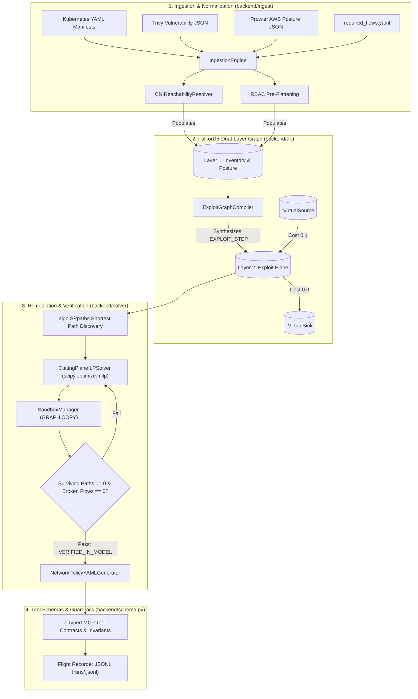

# Fjord: Automated Cloud & Container Security Posture and Attack-Path Remediation Agent

> Provably safe, counterfactually verified attack-path severing and minimal-diff Kubernetes remediation powered by FalkorDB native graph algorithms and mixed-integer linear programming (MILP).

---

## Demo

```
--- [Task 0 Vertical Slice Verification Run] ---
[+] Ingestion: Loaded 3 workloads, 1 Service, 1 EntryPoint, 1 CrownJewel
[+] Exploit Plane: Compiled 4 :EXPLOIT_STEP edges in FalkorDB (prod_t0slice)
[+] Attack Path Discovery (algo.SPpaths):
    (:VirtualSource) -> ingress-gw -> ingress-proxy -> api-service -> crown-jewel-db -> (:VirtualSink)
    Total hops: 4 | Bottleneck identified: api-service -> crown-jewel-db
[+] ILP Cutting-Plane Solver (scipy.optimize.milp):
    Selected Action: NETWORK_POLICY_ADD on workload 'crown-jewel-db' (Disruption Cost: 1.0)
    Preserved Required Flows: customer_api_traffic (ingress-proxy -> api-service) [OK]
[+] Counterfactual Sandbox Simulation (GRAPH.COPY prod_t0slice sandbox_sim_t0):
    Mutations Applied: 1 (Severed unisolated lateral network edge)
    Exploit Plane Re-compiled in Sandbox: 0 surviving attack paths
    Broken Required Flows: 0
    Verification Status: VERIFIED_IN_MODEL
[+] Manifest Synthesis: Generated minimal-diff Kubernetes NetworkPolicy (networking.k8s.io/v1)
```

> **TODO:** Add screencast GIF / video walkthrough of the interactive 3-pane command center once the frontend dashboard build is published.

---

## Why This Exists

Modern cloud-native environments run with hundreds of microservices, overlapping Kubernetes RBAC permissions, and multi-tenant network policies. Traditional Cloud Security Posture Management (CSPM) tools and vulnerability scanners generate thousands of isolated alerts without assessing actual multi-hop exploitability. Existing graph-based tools can visualize attack paths, but they lack automated, mathematically sound remediation—leaving engineers to manually guess which policies to apply without breaking production traffic. Furthermore, naive LLM security agents often hallucinate invalid Cypher queries or recommend blanket network cuts that disrupt business dependencies.

Fjord addresses this with a deterministic, dual-layer graph architecture built directly on **FalkorDB**:
1. **Layer 1 (Inventory & Posture):** Normalizes Kubernetes manifests, Trivy vulnerability scans, and Prowler cloud audit findings, pre-flattening RBAC permissions and calculating CNI network reachability matrices.
2. **Layer 2 (Exploit-State Plane):** Compiles multi-hop lateral attack paths inside FalkorDB using parameterized Cypher and connects external entry points to protected assets via virtual super-sources and super-sinks.
3. **Cutting-Plane MILP Remediation:** Formulates a minimum hitting-set problem with `scipy.optimize.milp` to find the lowest-disruption set of fixes while strictly preserving hard-coded business flows.
4. **Counterfactual In-Graph Sandboxing:** Clones the graph in milliseconds via native `GRAPH.COPY`, simulates candidate mutations, and mathematically verifies $0$ surviving paths and $0$ broken flows before generating copyable Kubernetes manifests.

---

## Features

- **Dual-Layer FalkorDB Graph**: Strict separation between raw infrastructure inventory (Layer 1) and compiled multi-hop attack steps (Layer 2).
- **Native Graph Traversal (`algo.SPpaths`)**: Uses FalkorDB native shortest-path procedures between `(:VirtualSource)` and `(:VirtualSink)` to identify attack chains in a single engine traversal without LLM query hallucination.
- **Deterministic CNI Reachability Truth Table**: Evaluates Kubernetes NetworkPolicy isolation, pod/namespace selectors (`matchLabels`, `matchExpressions`), and port/protocol rules into explicit `:CAN_REACH_NET` relationships.
- **Pre-Flattened RBAC Graph Projections**: Pre-computes Kubernetes RBAC wildcards, resource names, and verbs into indexed boolean flags (`allows_secrets_get`, `allows_pods_exec`, etc.) on `:ALLOWS_API` edges during ingestion.
- **Cutting-Plane MILP Solver**: Solves the minimum hitting-set problem over active attack paths using `scipy.optimize.milp`, minimizing workload disruption costs subject to hard invariant constraints ($x_m = 0$ for all required dependencies).
- **Counterfactual In-Graph Sandboxing**: Clones production snapshot graphs via native `GRAPH.COPY` into ephemeral `sandbox_sim_<id>` instances to simulate and verify remediations prior to operator review.
- **Minimal-Diff NetworkPolicy Generator**: Emits standard Kubernetes `networking.k8s.io/v1` manifests with collateral policy splitting to prevent unintended isolation of adjacent workloads.
- **Strict Guardrails & Schema Invariants**: Single source of truth in `backend/schema.py` governing 16 node labels, 16 relationship types, and 7 typed tool interfaces, complete with prompt-injection XML isolation (`<untrusted_data>`).

---

## Architecture

Fjord's data pipeline separates ingestion, graph modeling, optimization, and simulation across distinct components:



### Graph Schema (Single Source of Truth)

All graph queries and node/edge mutations adhere strictly to [`backend/schema.py`](backend/schema.py):

| Entity Type | Exact Members (16 Labels & 16 Relationships) |
| :--- | :--- |
| **Node Labels (16)** | `EntryPoint`, `Ingress`, `Service`, `Workload`, `Container`, `PostureFinding`, `ServiceAccount`, `RBACRole`, `WorkerNode`, `IAMRole`, `CrownJewel`, `NetworkPolicy`, `AttackerState`, `VirtualSource`, `VirtualSink`, `IAMPolicy` *(+ `RemediationRecord` in sentinel memory)* |
| **Relationship Types (16)** | `EXPOSES`, `ROUTES_TO`, `SELECTS`, `HAS_CONTAINER`, `AFFECTED_BY`, `CAN_REACH_NET`, `USES_SA`, `BOUND_TO`, `ALLOWS_API`, `MOUNTS_SECRET`, `MOUNTS_HOST`, `HOSTS_WORKLOAD`, `ASSUMES_IAM_ROLE`, `ALLOWS_CLOUD_ACCESS`, `REQUIRED_DEPENDENCY`, `EXPLOIT_STEP` |

---

## Quick Start

### Prerequisites

- **OS**: Windows 10/11, Linux, or macOS.
- **Python**: 3.12+
- **Docker Desktop**: For running the FalkorDB container.
- *(Optional)* **Kubernetes CLI (`kubectl`) & `kind`**: For running live cluster enforcement tests.

### 1. Clone & Set Up Python Environment

```powershell
# Clone the repository
git clone https://github.com/your-org/fjord.git
cd fjord

# Create and activate a virtual environment
python -m venv .venv
.\.venv\Scripts\Activate.ps1

# Install dependencies
pip install -r requirements.txt
```

### 2. Start FalkorDB via Docker

Fjord connects to FalkorDB on port `6380` by default (mapped from container port `6379`):

```powershell
docker run -d --name falkordb-fjord -p 6380:6379 falkordb/falkordb:latest
```

### 3. Configuration

Fjord works out-of-the-box with local defaults. Environment variables can be configured in a `.env` file or shell session:

| Variable | Purpose | Required / Optional | Default |
| :--- | :--- | :--- | :--- |
| `FALKORDB_HOST` | Hostname of the FalkorDB instance | Optional | `localhost` |
| `FALKORDB_PORT` | Port of the FalkorDB instance | Optional | `6380` |
| `FALKORDB_GRAPH` | Primary production graph name | Optional | `fjord_main` |
| `MAX_SNAPSHOT_GRAPHS` | Max ephemeral sandbox snapshots retained in LRU cache | Optional | `10` |
| `GEMINI_API_KEY` | Google Gemini API key for agent reasoning (`gemini-3.8-flash`) | Optional (BYOK in UI / offline graph solver runs without it) | `None` |

### 4. Run System Startup Check

Verify FalkorDB connectivity, native `algo.SPpaths` execution, and `GRAPH.COPY` cloning:

```powershell
python backend/startup_check.py
```

Expected output:
```
[*] Checking FalkorDB connection on localhost:6380...
[+] FalkorDB is reachable.
[*] Testing FalkorDB native algo.SPpaths procedure...
[+] algo.SPpaths verified: found 1 path(s).
[*] Testing FalkorDB native GRAPH.COPY command...
[+] GRAPH.COPY verified: successfully cloned 2 nodes into sandbox.
[=] All critical FalkorDB invariants passed successfully.
```

---

## Usage Examples

### 1. Ingest Cluster Data & Compile the Exploit Plane

Parse Kubernetes YAML manifests, Trivy vulnerability reports, and required dependency contracts into Layer 1, then synthesize Layer 2 attack steps:

```python
from backend.db.connection import db_manager
from backend.ingest.parser import IngestionEngine
from backend.db.compiler import ExploitGraphCompiler

GRAPH_NAME = "demo_cluster"

# Ingest infrastructure manifests & vulnerability feeds
engine = IngestionEngine()
with open("tests/fixtures/sample_cluster.yaml") as f:
    engine.parse_k8s_yaml(f.read())
with open("tests/fixtures/trivy_report.json") as f:
    engine.parse_trivy_json(f.read())
with open("tests/fixtures/required_flows.yaml") as f:
    engine.parse_required_flows_yaml(f.read())

# Populate Layer 1 (Inventory & Posture)
counts = engine.resolve_cni_and_populate_graph(GRAPH_NAME)
print(f"Populated {counts['node_count']} nodes and {counts['edge_count']} edges.")

# Compile Layer 2 (Exploit-State Plane)
compiler = ExploitGraphCompiler(GRAPH_NAME)
stats = compiler.compile()
print(f"Compiled {stats['total_exploit_steps']} attack steps: {stats['steps_by_type']}")
```

### 2. Solve for Minimal Disruption Remediations (MILP)

Run the cutting-plane solver to sever all paths from `(:VirtualSource)` to `(:VirtualSink)` without cutting required business dependencies:

```python
from backend.solver.ilp_solver import CuttingPlaneILPSolver

solver = CuttingPlaneILPSolver(graph_name="demo_cluster", preserve_required_flows=True)
candidates = solver.enumerate_candidates()
result = solver.solve(candidates, max_iterations=20)

print(f"Solver Status: {result.solver_status}")
print(f"Selected {len(result.selected_actions)} remediation actions (Cost: {result.total_cost}):")
for action in result.selected_actions:
    print(f" - [{action.remediation_type.value}] {action.description}")
```

### 3. Verify in Counterfactual Sandbox & Emit Kubernetes YAML

Simulate candidate actions inside an ephemeral clone using native `GRAPH.COPY` and emit audit-stamped NetworkPolicy YAML:

```python
from backend.solver.sandbox import SandboxManager
from backend.solver.yaml_generator import NetworkPolicyYAMLGenerator

# Simulate inside sandbox
sandbox = SandboxManager(auto_cleanup=True)
report = sandbox.simulate("demo_cluster", result.candidate_set_id, result.selected_actions)

print(f"Verification Status: {report.verification_status.value}")
print(f"Surviving Paths: {report.surviving_attack_paths} | Broken Flows: {report.broken_required_flows}")

# Generate deployable NetworkPolicy YAML
if report.verification_status.value == "VERIFIED_IN_MODEL":
    generator = NetworkPolicyYAMLGenerator(graph_name="demo_cluster")
    manifests = generator.generate(result.selected_actions)
    for manifest in manifests:
        print("\n--- Generated Kubernetes Manifest ---\n" + manifest)
```

### 4. Run the End-to-End Vertical Slice

Execute the complete end-to-end Task 0 vertical slice script:

```powershell
python tests/task0_vertical_slice.py
```

---

## Project Structure

```
Fjord/
├── agents.md                     # Agentic development rules and invariants
├── architecture.md               # System design, data flow, and architectural principles
├── prd.md                        # Product requirements document and design targets
├── pytest.ini                    # Pytest configuration
├── requirements.txt              # Core project dependencies
├── backend/
│   ├── schema.py                 # Single source of truth: 16 node labels, 16 rels, MCP schemas
│   ├── startup_check.py          # Pre-flight validation (FalkorDB, procedures, Gemini API)
│   ├── db/
│   │   ├── connection.py         # FalkorDB client, LRU cache, GRAPH.COPY, algo.SPpaths
│   │   └── compiler.py           # Parameterized Cypher compiler for Layer 2 exploit plane
│   ├── ingest/
│   │   ├── cni_resolver.py       # CNI truth-table reachability solver (ingress/egress policies)
│   │   └── parser.py             # Multi-source ingest (K8s YAML, Trivy, Prowler, RequiredFlows)
│   └── solver/
│       ├── __init__.py           # Solver package exports
│       ├── ilp_solver.py         # Cutting-plane minimum hitting-set solver (scipy.optimize.milp)
│       ├── sandbox.py            # Counterfactual GRAPH.COPY sandbox simulation manager
│       └── yaml_generator.py     # Minimal-diff Kubernetes NetworkPolicy YAML generator
├── deploy/
│   └── kind/                     # Local test cluster manifests (Calico CNI, task workloads)
└── tests/
    ├── fixtures/                 # Sample K8s YAML, Trivy JSON, Prowler JSON, required flows
    ├── task0_vertical_slice.py   # E2E vertical slice script
    ├── test_compiler_monotonicity.py # Invariant tests: post-remediation <= pre-remediation edges
    └── test_ilp_solver.py        # Integration test suite for ILP solver & sandbox
```

---

## Development & Testing

### Running Tests

Run the full integration test suite with `pytest`:

```powershell
# Run all tests (requires running FalkorDB instance)
pytest -v

# Run monotonicity property tests (verifies no new attack paths are introduced)
pytest tests/test_compiler_monotonicity.py -v

# Run ILP solver & sandbox verification tests
pytest tests/test_ilp_solver.py -v
```

### Development Guidelines

For AI coding agents and contributors implementing tools or graph modifications, review [`agents.md`](agents.md) for non-negotiable core invariants:
- **Zero Hallucination on Rules**: Never execute unparameterized raw Cypher; always use parameterized templates and native algorithms (`algo.SPpaths`).
- **Single Source of Truth**: All node labels and edge types must strictly originate from [`backend/schema.py`](backend/schema.py).
- **Verification Gates**: Never commit remediations without a prior successful sandbox run achieving $0$ surviving paths and $0$ broken flows.
- **Flight Recorder**: Log all events to structured JSONL files.

---

## Roadmap & Current Limitations

- **FastMCP Server & UI Runtime**: Tool schemas, verification contracts, and UI models are strictly defined in [`backend/schema.py`](backend/schema.py); the live FastMCP server endpoint wrapper and interactive 3-pane web frontend are currently in development.
- **Cloud IAM Providers**: Automated IRSA `AssumeRoleWebIdentity` bridge compilation is implemented for AWS findings via Prowler. Support for GCP Workload Identity and Azure Managed Identities is planned.
- **Egress Policy Generation**: NetworkPolicy synthesis currently generates ingress allow-lists; automated egress policy generation with external CIDR blocks is planned.
- **Performance Benchmarks**: Metrics cited in `prd.md` (`< 30ms` traversal on 500 workloads, `0/50` injection resistance) represent design targets and will be benchmarked formally once test cluster scale generators are committed.

---

## Contributing & License

- **Project Status**: Developed for Track 1 of the WeMakeDevs FalkorDB Hackathon ("Agents That Act on Connected Data").
- **License**: Pending repository license specification.
- **Contributing**: Refer to [`agents.md`](agents.md) for coding conventions, schema constraints, and safety invariants.
