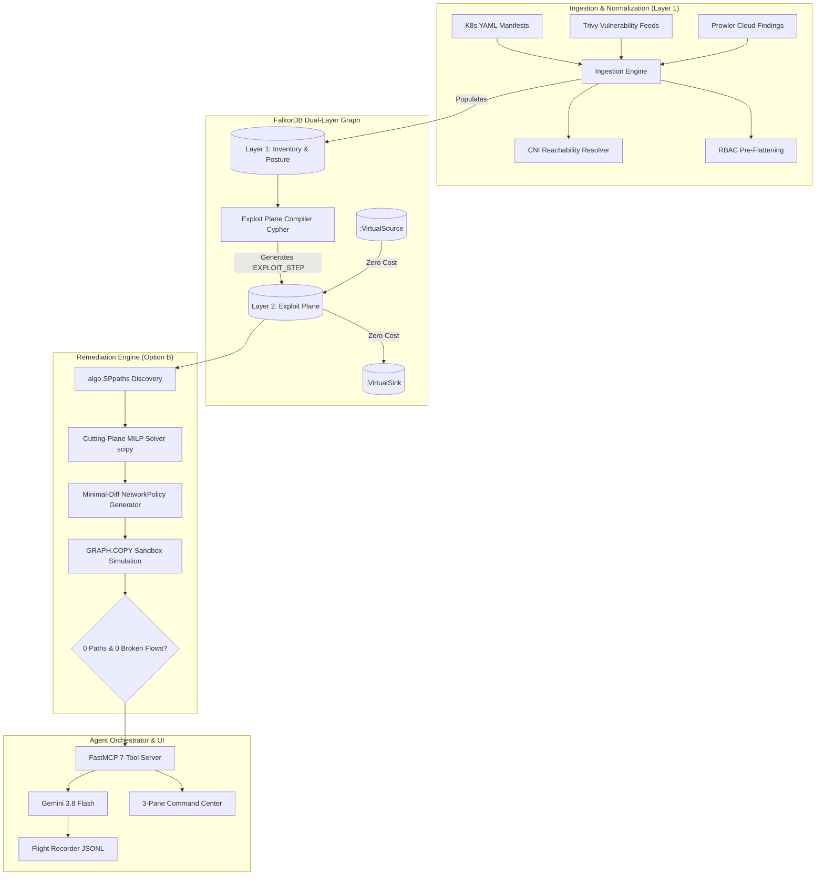

# Architecture & System Design: Project Fjord

## 1. Overview & Architectural Principles

Project **Fjord** is an automated cloud & container security posture and attack-path remediation agent built on **FalkorDB**. It provides provably safe, counterfactually verified attack-path severing for Kubernetes and multi-cloud environments.

## 2. Core Decisions

### Option B: FalkorDB-Native Exploit Compilation
- Exploit-plane rules (`:EXPLOIT_STEP`) are compiled via parameterized Cypher queries executed directly inside FalkorDB.
- Python is used strictly for:
  1. The CNI reachability truth-table resolver.
  2. The `scipy.optimize.milp` Cutting-Plane ILP solver.
  3. The FastAPI / FastMCP orchestrator.
- NetworkX is strictly confined to unit test suites as an independent verification oracle to cross-check `algo.SPpaths` results on small benchmark graphs.

### Virtual Super-Source & Super-Sink
- To enable single-query all-pairs path discovery and efficient cutting-plane iterations:
  - All external entry points (`:EntryPoint`, internet-facing `:Ingress`, public `:Service`) connect to a single virtual node `(:VirtualSource)` via zero-cost `:EXPOSES` / `:EXPLOIT_STEP` edges.
  - All protected high-value assets (`:CrownJewel`, sensitive secrets, cloud databases) connect to a single virtual node `(:VirtualSink)` via zero-cost `:EXPLOIT_STEP` edges.
- A single call to FalkorDB's native algorithm `algo.SPpaths({sourceNode: v_src, targetNode: v_sink})` identifies the shortest attack path in a single graph traversal.

### RBAC Pre-Flattening
Complex Kubernetes RBAC rules (regexes, wildcards, apiGroups) are pre-flattened during ingestion into boolean property flags on the `:ALLOWS_API` edge:
- `allows_secrets_get: bool`
- `allows_pods_exec: bool`
- `allows_pods_create_patch: bool`
- `allows_impersonate: bool`
- `allows_bind_escalate: bool`
- `is_wildcard: bool`
- `is_cluster_scoped: bool`
- `resource_names: List[str]`

This allows parameterized Cypher compilation queries to match privilege escalation steps without regex evaluation overhead during traversal.

### CNI Reachability Truth Table
Network reachability between workloads is calculated using a deterministic 4-step truth table:
1. Identify all `NetworkPolicy` objects selecting the source workload (egress) and target workload (ingress).
2. If no policies select the workload, the default is ALLOW (non-isolated).
3. If policies select the workload, isolation is active; traffic is denied unless matched by at least one ingress rule and one egress rule.
4. The resolver outputs explicit `:CAN_REACH_NET` relationships between workloads, annotated with port and protocol.

## 3. Data Schema Source-of-Truth

All graph operations adhere strictly to the 16 Node Labels and 16 Relationship Types defined in `backend/schema.py`:

### Exact 16 Node Labels
1. `EntryPoint`
2. `Ingress`
3. `Service`
4. `Workload`
5. `Container`
6. `PostureFinding`
7. `ServiceAccount`
8. `RBACRole`
9. `WorkerNode`
10. `IAMRole`
11. `CrownJewel`
12. `NetworkPolicy`
13. `AttackerState`
14. `VirtualSource`
15. `VirtualSink`
16. `IAMPolicy`
*(Plus `RemediationRecord` in sentinel memory graph)*

### Exact 16 Relationship Types
1. `EXPOSES`
2. `ROUTES_TO`
3. `SELECTS`
4. `HAS_CONTAINER`
5. `AFFECTED_BY`
6. `CAN_REACH_NET`
7. `USES_SA`
8. `BOUND_TO`
9. `ALLOWS_API`
10. `MOUNTS_SECRET`
11. `MOUNTS_HOST`
12. `HOSTS_WORKLOAD`
13. `ASSUMES_IAM_ROLE`
14. `ALLOWS_CLOUD_ACCESS`
15. `REQUIRED_DEPENDENCY`
16. `EXPLOIT_STEP`

## 4. Remediation Engine & Verification Gates

### Cutting-Plane ILP Hitting-Set Formulation
- The attack graph contains candidate edge mutations $M = \{e_1, e_2, \dots, e_k\}$.
- Each mutation carries a disruption cost $c(e)$ (e.g., adding a NetworkPolicy has low cost; removing an RBAC binding has medium cost; taking down a service has high cost).
- Objective: $\min \sum_{e \in M} c(e) x_e$ subject to hitting every active attack path $P$: $\sum_{e \in P} x_e \ge 1$, while preserving required dependencies ($x_e = 0$ for all $e \in \text{RequiredDependencies}$).
- Solved iteratively with cutting planes using `scipy.optimize.milp`.

### Counterfactual Sandbox Simulation
- Prior to any remediation commit, the system clones the snapshot graph via FalkorDB `GRAPH.COPY prod_<sha8> sandbox_sim_<id>`.
- The candidate mutation is applied in the sandbox graph.
- The exploit plane is re-compiled inside the sandbox graph.
- Path elimination is checked via `algo.SPpaths`.
- Gate invariant: Exactly 0 surviving attack paths and 0 broken required business flows are permitted.

## 5. Agent Orchestrator & FastMCP Interface

The agent communicates with the LLM via FastMCP exposing exactly 7 typed tools:
1. `get_posture_and_cluster_summary`
2. `discover_attack_paths`
3. `compute_optimal_remediations`
4. `inspect_resource_context`
5. `update_dependency_or_constraint` (Propose-only with quote check)
6. `simulate_fix_in_sandbox`
7. `commit_verified_remediation` (Strictly requires prior sandbox verification)

### Security & Guardrails
- **Prompt Injection Defense:** Model inputs from cluster descriptions, logs, or scanner outputs are wrapped in `<untrusted_data>` tags and truncated to 2048 characters.
- **Flight Recorder:** Structured event logs written to `runs/<session_id>.jsonl`.
- **UI-Only Authorization:** `record_operator_decision` is excluded from the model's MCP schema; approvals must originate from validated UI tokens.

## 6. Runtime & Environment Specs
- **OS & Runtime:** Native Windows 11, PowerShell, Python 3.12, Docker Desktop.
- **Database:** FalkorDB latest running in Docker (`0.0.0.0:6380->6379`).
- **Model:** `gemini-3.8-flash` with low/medium thinking level; GA fallback to `gemini-3.6-flash`.
- **Startup Check:** `backend/startup_check.py` validates Gemini connectivity, FalkorDB `GRAPH.COPY`, and `algo.SPpaths` before accepting requests.
